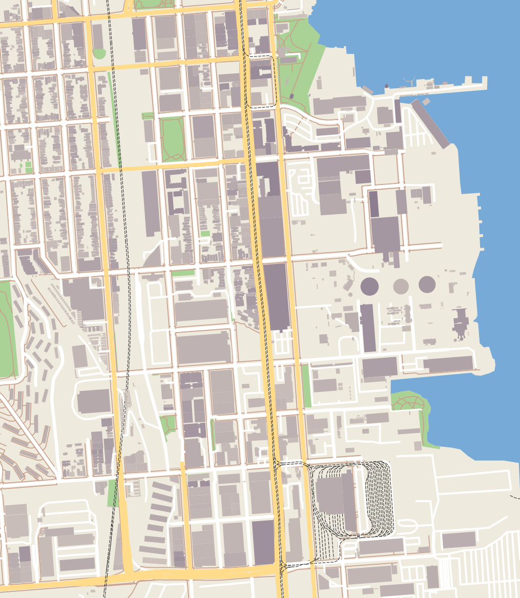

# crosstalk-yc-hack

A low-poly open-world game set in San Francisco's Dogpatch neighborhood, built as a native Unity 6.3 iOS app.

Walk the real street grid, tap a parked car to get in, and drive down Tennessee, 3rd or 22nd Street. The city is generated in C# at startup from OpenStreetMap streets and DataSF building footprints, dressed with flat-shaded Polyfork models.



## Layout

| Path | What |
| --- | --- |
| `unity/` | Unity 6000.3.28f1 project. One generated bootstrap scene; everything else is built from code and data. |
| `unity/Assets/Resources/World/dogpatch.json` | Processed street, rail, park, land and building extract (committed, so startup needs no network). |
| `unity/Assets/Resources/Polyfork/` | Polyfork GLBs (as `.bytes`) and `catalog.json`. |
| `tools/DataPrep/` | .NET 8 tool that fetches OSM, DataSF and Polyfork and writes the files above. |
| `scripts/` | Headless Unity install, license activation, and build scripts. |
| `backend/` | Convex backend (separate work; the game does not call it yet). |

## How it works

- **World** (`Runtime/World`): `WorldBuilder` triangulates land and parks, lays streets as mitred ribbons with sidewalks and centre lines, extrudes each footprint to its DataSF height (median LiDAR height `hgt_median_m`, then OSM `height`/`building:levels`, else 7 m) with window bands, and chunks everything into 200 m meshes. `PropPlacer` scatters street lights, trees, hydrants, traffic lights, benches and rooftop units along the real streets and merges them per chunk.
- **Polyfork models** (`Runtime/Glb`): Unity's importer ignores glTF `COLOR_0`, which is where Polyfork keeps all colour, so `GlbAsset` parses the GLB bytes directly (nodes, meshes, skins, animation clips) and bakes `COLOR_0` into `Mesh.colors`. The player and NPCs are skinned and play the file's Idle/Walk/Run clips through `GlbAnimator`.
- **Look**: one shader, `Dogpatch/FlatVertexColor`, reads vertex colour and computes a per-face normal from screen-space derivatives, so every triangle is flat-shaded. It also takes the sun, hard shadows and fog.
- **Controls** (`Runtime/Gameplay`): one drag-anywhere control. The drag direction (relative to the camera at touch-down) is the direction of travel, and a longer drag goes faster. Releasing lets you coast to a stop. A tap jumps on foot. Tapping a car gets in, and tapping your car while driving gets out. A third-person camera follows.

## Backend seam

Everything a server would own sits behind `Dogpatch.Backend.IGameBackend` (`unity/Assets/Scripts/Runtime/Backend`): the player profile and id, the player's position, heading and mode (`onFoot`/`driving`), which vehicle they're in, the state of every vehicle, and saving and loading. There is one async method per endpoint of the Convex HTTP contract (`POST/GET /api/players`, `GET/PUT /api/player-state`, `GET /api/vehicles`, `POST /api/vehicles/enter|exit|update`). The wire classes in `BackendModels.cs` use the contract's JSON field names, so `JsonUtility` can read Convex responses directly. Failures throw `BackendException` with the contract's error code.

The app ships with `InMemoryGameBackend`, which enforces the same rules and error codes and makes no network calls. `GameController` is the only code that touches the backend: it creates and stores the player id, seeds the parked cars, enters and exits vehicles through the interface, and checkpoints position every 2 s. Switching to Convex means writing an HTTP implementation of `IGameBackend` and constructing it in `GameController.Start`.

## Rebuild the data

```
dotnet run --project tools/DataPrep -c Release            # uses data/cache/ when present
dotnet run --project tools/DataPrep -c Release -- --refresh
```

This needs the .NET 8 SDK. Bounds are constants in `tools/DataPrep/Program.cs`. Polyfork model ids by role are in `tools/DataPrep/models.json`. See `tools/DataPrep/README.md`.

## Build

All builds are headless (`-batchmode -nographics -executeMethod`).

1. Install Unity. On Linux, run `./scripts/install-unity-linux.sh`, which installs the editor and iOS module into `~/Unity/6000.3.28f1`. On macOS, install 6000.3.28f1 with iOS support through the Hub, or set `UNITY_PATH` to the editor binary.
2. Activate a license with `./scripts/unity-activate.sh`:
   - Personal: set `UNITY_EMAIL` and `UNITY_PASSWORD`. The script activates a Personal seat on the machine through Unity's licensing client. A `.ulf` from another machine will not work, because it is machine-bound.
   - Pro/Plus: also set `UNITY_SERIAL`.
3. Export the iOS Xcode project with `./scripts/build-ios.sh`, which writes `Builds/iOS-<sdk>`:

   | Variable | Default | Meaning |
   | --- | --- | --- |
   | `IOS_SDK` | `simulator` | `simulator` builds for the arm64 iOS Simulator SDK. `device` builds a signing-ready project for the device SDK. |
   | `IOS_BUNDLE_ID` | `com.crosstalk.dogpatch` | Bundle identifier. |
   | `APPLE_TEAM_ID` | empty | Team for automatic signing. Set it for device builds. |
   | `BUILD_OUTPUT` | `Builds/iOS-<sdk>` | Output folder. |

4. Build the app on a Mac:
   - Simulator: run `./scripts/stage-ios-remote.sh`, which packs the export into `Builds/ios-remote/` (about 63 MB, under Revyl's 100 MB upload cap). Then run `./build.sh` in that folder on macOS. It produces `build/Build/Products/Release-iphonesimulator/Dogpatch.app`.
   - Device: open `Builds/iOS-device/Unity-iPhone.xcodeproj` and run on a connected iPhone. Automatic signing uses `APPLE_TEAM_ID`. Alternatively, run `xcodebuild -allowProvisioningUpdates`.
5. Optional: `./scripts/build-linux.sh` builds a Linux desktop player (`Builds/Linux/Dogpatch.x86_64`). It's handy for checking the city on a Linux box, and the mouse stands in for touch.

## Data and attribution

Streets © OpenStreetMap contributors (ODbL). Building footprints come from DataSF Building Footprints (`ynuv-fyni`). Low-poly models come from [polyfork.dev](https://polyfork.dev).
